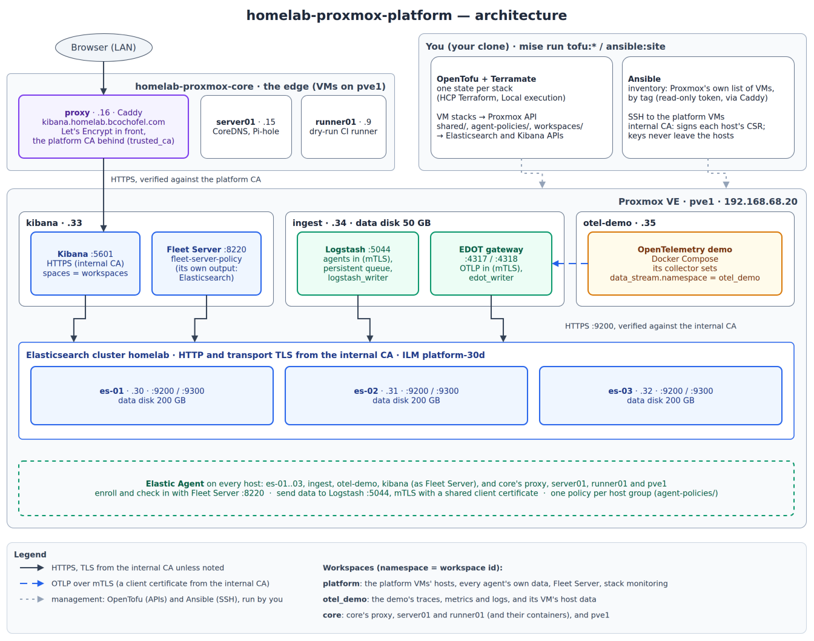

# homelab-proxmox-platform

Everything behind the homelab's edge: an Elastic Stack and the
OpenTelemetry demo that sends it data, on Proxmox VMs. The edge itself (the
Caddy reverse proxy and the CoreDNS + Pi-hole DNS pair) is
[`homelab-proxmox-core`](https://github.com/BCochofelHomelab/homelab-proxmox-core),
whose conventions and guardrails this repository follows.

| VM | IP | Runs |
| --- | --- | --- |
| `es-01`, `es-02`, `es-03` | `192.168.68.30`–`.32` | Elasticsearch |
| `kibana` | `.33` | Kibana and Fleet Server |
| `ingest` | `.34` | Logstash and the EDOT gateway |
| `otel-demo` | `.35` | The OpenTelemetry demo |

## Architecture



Editable source: [`docs/diagrams/architecture.drawio`](docs/diagrams/architecture.drawio)
(open in [app.diagrams.net](https://app.diagrams.net) or the draw.io desktop
app; export the PNG next to it after a change).

## How it's organized

Observability is offered as **workspaces**: a workspace is a Kibana space
with its own data, access, dashboards and alerts, for one owner and one
audience. Data reaches a workspace through its data stream namespace, which
is the workspace id. Each workspace comes from the
[`terraform-elasticstack-workspace`](https://github.com/BCochofelHomelab/terraform-elasticstack-workspace)
module.

Every resource belongs to one of three scopes, and goes in the narrowest
one that contains everyone its change affects:

| Scope | Examples |
| --- | --- |
| **Shared** | Integration packages, Fleet outputs and Fleet Server, ILM, index templates, ingest pipelines, platform roles |
| **Per host group** | An agent policy and its integrations |
| **Per workspace** | A space, its data views, dashboards, rules and roles |

[Terramate](https://terramate.io) splits them into stacks, each with its
own OpenTofu state, so a change plans and applies only where it belongs.

| Path | Stack |
| --- | --- |
| `platform/elastic/`, `apps/otel-demo/` | The VMs (tag `proxmox`) |
| `shared/security`, `shared/data`, `shared/fleet` | Shared Elastic content (tag `elastic`) |
| `agent-policies/<group>/` | One host group's agent policy (tag `elastic`) |
| `workspaces/<id>/` | One workspace (tag `elastic`) |

A stack holds only its own resources. Its backend (one HCP Terraform
workspace, `platform-<path>`) and its one provider are generated by
`terramate generate` from [`terramate/`](terramate/), by tag, with the
shared values in [`terramate.tm.hcl`](terramate.tm.hcl): a VM stack never
gets Elastic credentials, and an Elastic stack never gets Proxmox ones.
Ansible, in [`ansible/`](ansible/), configures the VMs between the two.

## Status

Everything is in: the VMs, Ansible's roles, the shared Elastic content
(`shared/`), the host groups' agent policies (`agent-policies/`) and the
workspaces (`workspaces/`): `platform` and `otel_demo`.

## Adding a workspace or a host group

Folders hold data; Terramate generates the code (`terramate/`).

- **A workspace:** `workspaces/<id>/` with a `stack.tm.hcl` (copy one),
  a `workspace.yaml` (the module's inputs; `module_ref` pins its release
  for this workspace), optional `dashboards/*.ndjson` (Kibana exports) and
  `rules/*.yaml`, and the comment-only `main.tf` and `outputs.tf` the
  others have. The id is the folder's name: `^[a-z0-9_]{1,64}$`, never
  `default`, and it's the namespace every source of its data must write
  to.
- **A host group:** `agent-policies/<group>/` with a `stack.tm.hcl`, an
  `agent-policy.yaml` (the policy, its integrations, each with the
  workspace its data belongs to) and the same two `.tf` files; then
  `elastic_agent_policy_id: <group>` in the group_vars of the VMs that
  join it.

`terramate generate`, then `mise run lint`: the contract check fails a
namespace or a policy id that names nothing.

## Getting started

Everything a contributor needs, from a clone, on Linux (Ubuntu or WSL2):

```bash
mise trust && mise install   # the pinned toolchain, Ansible in .venv, git hooks
mise run check               # what CI runs
```

Applying (yours only: each runs one command with
`~/.secrets/homelab.yaml`):

```bash
mise run tofu:init           # every stack under the current directory
mise run tofu:plan           # each saved to its stack's tfplan: review it
mise run tofu:apply          # applies those plans
mise run ansible:site        # every platform VM; extra args after --
```

`tofu:*` run every stack below where you run them, in order: from the
repo root, all of them; from `platform/elastic`, that one. The Elastic
stacks write with one API key, `ELASTICSEARCH_API_KEY`, scoped to what
they manage: how it's created, checked and rotated is
[`docs/ELASTIC-API-KEY.md`](docs/ELASTIC-API-KEY.md). Ansible finds
the VMs in Proxmox by tag (`ansible/inventory/platform.proxmox.yml`), with
its own read-only token.

What runs where: Elasticsearch, Kibana and Logstash from Elastic's DEB
packages; Fleet Server and the EDOT Collector gateway from Elastic's
signed Elastic Agent tarball; the OpenTelemetry demo in Docker Compose.
TLS inside the stack comes from an internal CA (`mise run pki:init`,
once). Ansible's secrets are in `ansible/inventory/group_vars/<group>.sops.yaml`,
one file per group that needs them. Fleet Server follows `shared/fleet`, and each
VM's Elastic Agent its host group's `agent-policies/<group>`: an
`ansible:site` before those exist skips them with a message, the one after
sets them up.

Every VM reporting its telemetry (its agent online in Fleet, its metrics
in Elasticsearch): `mise run check:telemetry`, read-only.

Building it from nothing, or rebuilding it, in order, with everything
configured by hand (Proxmox, HCP Terraform, Elastic, GitHub, the secret
files): [`docs/SETUP.md`](docs/SETUP.md).

How a change flows, and the rules it follows:
[`CONTRIBUTING.md`](CONTRIBUTING.md).
